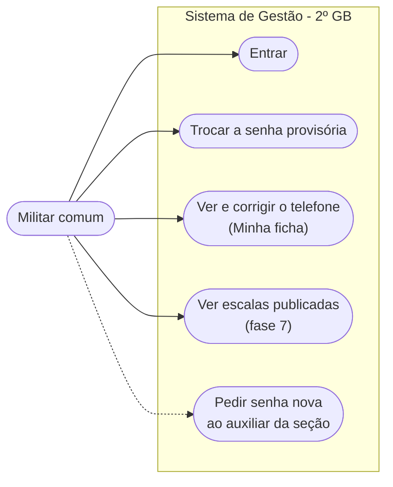
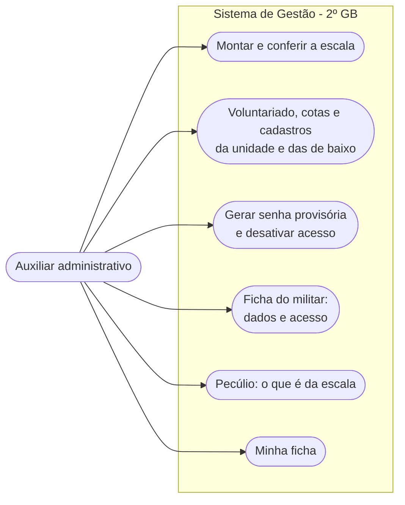
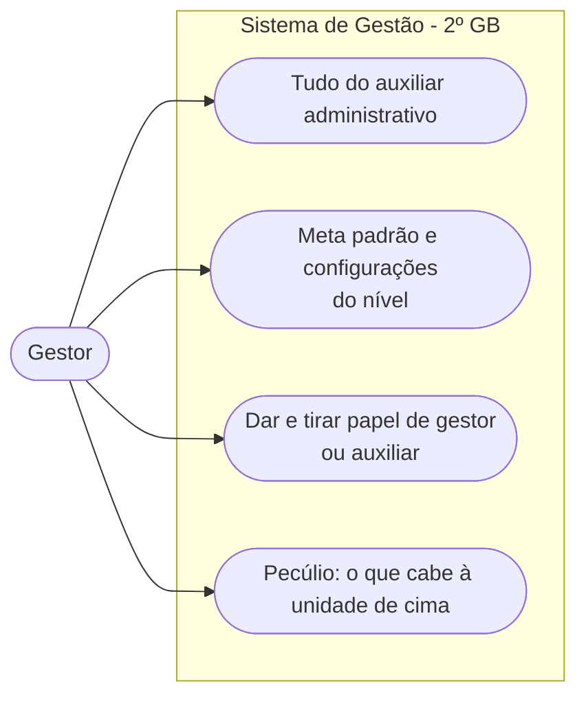
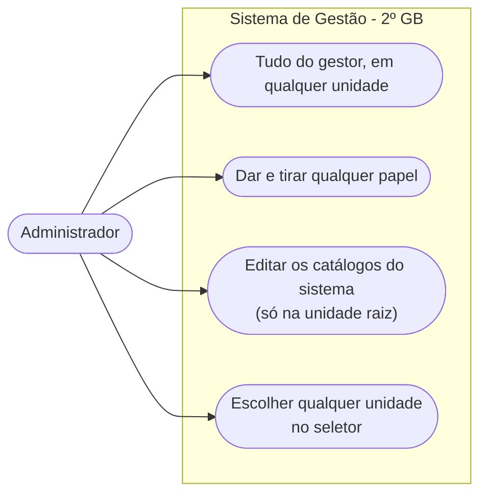

# Casos de uso por tipo de usuário

Quem pode fazer o quê no Sistema de Gestão - 2º GB, um diagrama por tipo de usuário. Quem cuida: DOCUMENTAÇÃO. Atualizado com a fase 6 (planejada em 21/11/2026, `superpowers/specs/2026-11-21-usuarios-e-modulos-design.md`). Quando a fase 6 for entregue, a DOCUMENTAÇÃO confere estes diagramas contra a tela.

Os quatro tipos são papéis, não cadastros: uma mesma pessoa pode ter mais de um (ex.: auxiliar administrativo na 1ª SB e gestor no 2º GB). Sem papel vigente, a pessoa é **militar comum**. Os papéis valem para a unidade dada e as de baixo, por período.

Nas telas, o papel de escalante aparece como **Auxiliar administrativo**. Nos textos de ajuda, quem monta a escala continua sendo "o escalante".

## Matriz resumo

| Caso de uso | Militar comum | Auxiliar administrativo | Gestor | Administrador |
|---|:-:|:-:|:-:|:-:|
| Entrar com e-mail e senha | ✔ | ✔ | ✔ | ✔ |
| Trocar a senha provisória no primeiro login | ✔ | ✔ | ✔ | ✔ |
| Ver e corrigir o próprio telefone ("Minha ficha") | ✔ | ✔ | ✔ | ✔ |
| Ver as escalas publicadas da unidade | ✔ (fase 7) | ✔ (fase 7) | ✔ (fase 7) | ✔ (fase 7) |
| Escolher a unidade de trabalho | só leitura | ✔ | ✔ | ✔ |
| Montar e conferir a escala (Grade geral, Escala do mês, Efetivo por dia) | — | ✔ | ✔ | ✔ |
| Voluntariado, cotas e cadastros da unidade | — | ✔ | ✔ | ✔ |
| Meta padrão e configurações do nível | — | — | ✔ | ✔ |
| Gerar senha provisória e desativar acesso | — | ✔ (unidade e abaixo) | ✔ (unidade e abaixo) | ✔ |
| Dar e tirar papel de gestor ou auxiliar | — | — | ✔ (unidade e abaixo) | ✔ |
| Dar e tirar papel de administrador | — | — | — | ✔ (só na raiz) |
| Editar os catálogos do sistema (tipos de afastamento, etc.) | — | — | — | ✔ (só na raiz) |
| Módulo Pecúlio do 2º GB | — | ✔ (o que é da escala) | ✔ (o que cabe à unidade de cima) | ✔ |

Regras que valem em todos os casos: ninguém encerra o próprio último papel de gestor (o administrador pode); a API confere o papel na unidade pedida, mesmo que o site esconda o botão; nenhuma regra de conta impede o escalante de fechar a escala.

## Militar comum

- Vê só o que é dele: a própria ficha e as escalas publicadas da unidade em que está lotado.
- Não vê cadastros, CNH nem afastamentos de outros militares (D7).
- O topo mostra o caminho da lotação dele, só para leitura. Não há seletor de unidade.
- "Esqueci minha senha" não envia e-mail: mostra "Peça uma senha nova ao auxiliar administrativo da sua seção".

## Auxiliar administrativo

- Pode tudo o que o militar comum pode, mais a confecção de escalas da unidade dele e das de baixo.
- Gera a senha provisória na ficha de militar da sua unidade ou das de baixo. A senha aparece uma vez, para entregar ao militar, e vale 7 dias.
- Não dá nem tira papel. Não edita a meta padrão nem as configurações do nível.

## Gestor

- Pode dar e tirar papel de **gestor e auxiliar administrativo** na unidade dele e nas de baixo. Não pode dar papel de administrador.
- Não tira o próprio último papel de gestor, para a unidade não ficar sem quem dê papéis por engano.
- Dar papel a quem ainda não tem conta é permitido: o papel vale quando a pessoa entrar.
- O papel "gestor" é o antigo "chefe" (RN-115).

## Administrador

- Só existe na unidade raiz. Pode dar qualquer papel, em qualquer unidade, e encerrar o próprio último papel de gestor.
- Para ele, o seletor de unidade mostra todas.
- Os catálogos do sistema (por exemplo, os tipos de afastamento) são só dele. As funções são de cada unidade e quem as cadastra é o escalante da unidade.

## Pontos em aberto

| Ponto | Situação |
|---|---|
| Militar comum com Visualização de escalas | O design da fase 6 mostra o cartão para todos, com "em breve" até a fase 7. A [telas](superpowers/specs/2026-11-16-telas.md) diz que o militar comum vê "Minha escala", que é da fase 7. Vale o design da fase 6; a fase 7 confirma. |
| Nome do papel | Nas telas, "Auxiliar administrativo" (decidido na fase 6). No banco, o valor continua `escalante`. Nos textos de ajuda, "o escalante". |
| Edição do Pecúlio pela unidade de cima | Dono por bloco, como na fase 5. Os detalhes de quem edita o quê estão em `superpowers/specs/2026-11-20-peculio-design.md`. |
