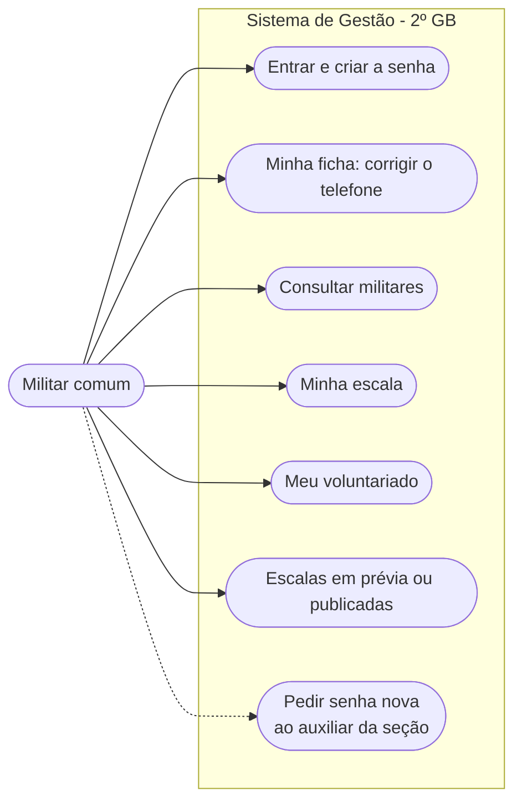
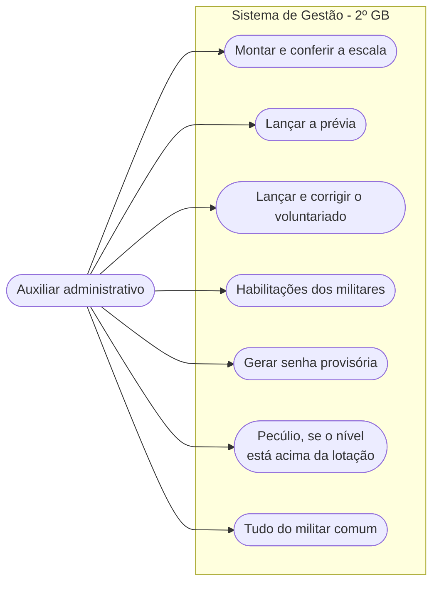
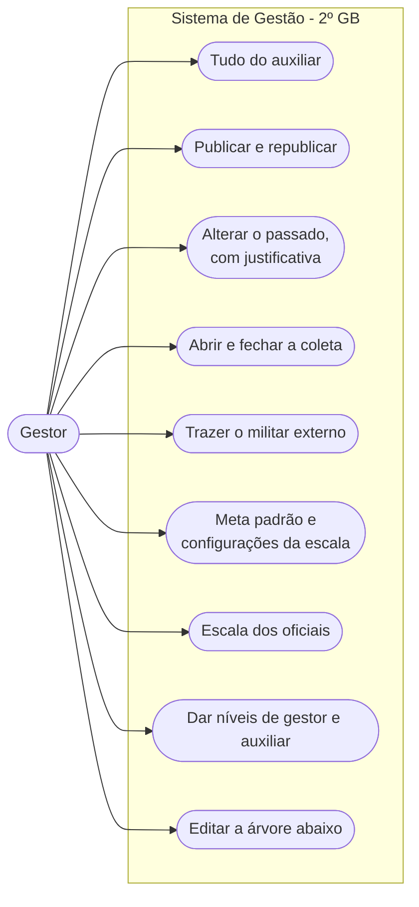
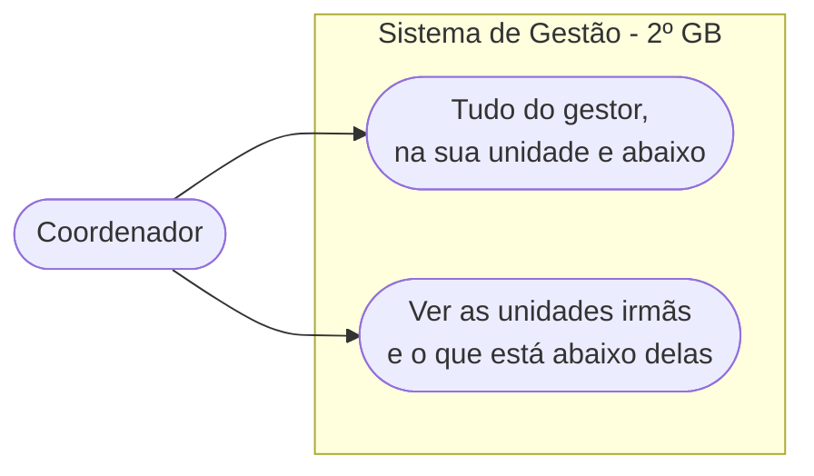
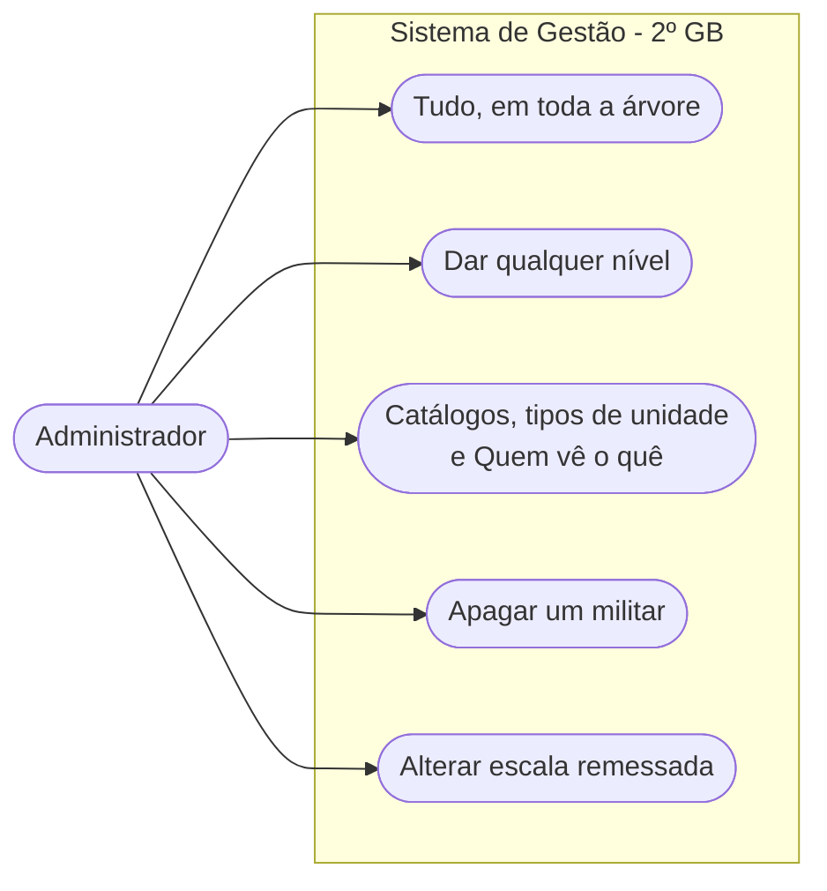

# Casos de uso por nível de acesso

Quem pode fazer o quê no Sistema de Gestão - 2º GB: um diagrama para o militar comum e um para cada nível de acesso. Quem cuida: DOCUMENTAÇÃO. Conferido em 25/11/2026 com as fases 6 e 7 mescladas (`main` depois da 7.5). As regras citadas estão no [catálogo](negocio/regras/LEIAME.md).

## Como ler

- **Nível de acesso** é o que a pessoa **edita**: é dado numa unidade, vale nela e nas de baixo, e tem período (RN-115). Uma pessoa pode ter mais de um (ex.: auxiliar na 1ª SB e gestor no 2º GB). Sem nível vigente, ela é **militar comum**.
- **O que a pessoa vê** de quem ela não edita vem das camadas de visão, que se somam: todos, oficial e coordenador (RN-133). O administrador ajusta a borda em Configurações › Quem vê o quê.
- Os níveis, do menor para o maior: **auxiliar administrativo** (o escalante), **gestor**, **coordenador** e **administrador**. Cada um faz tudo o que o anterior faz.
- **O Pecúlio depende de onde está o nível, não de qual é:** quem tem nível numa unidade **acima** da lotação do militar (a "SP") edita a ficha dele; quem tem nível só na lotação edita as Habilitações e vê o resto (RN-135).
- A API confere o nível na unidade pedida em toda gravação, mesmo que a tela esconda o botão. Nenhuma regra de acesso impede o escalante de montar ou corrigir a escala.

## Módulos da tela inicial

| Módulo | Quem vê o cartão | O que tem |
|---|---|---|
| Confecção de escalas | quem tem nível de acesso | Grade geral, Escala do mês, Efetivo por dia, Oficiais, Militares, Cotas, Voluntariado, cadastros e Configurações da escala |
| Visualização de escalas | todos | Minha escala, Meu voluntariado e Escalas |
| Pecúlio | todos | Quem tem nível: o Pecúlio da unidade, a pesquisa, os aniversários e a ficha completa. Militar comum: só a Consulta de militares |
| Estrutura | quem tem nível de acesso | A árvore de unidades e os tipos de unidade |
| Configurações | todos | O painel geral: cada seção aparece para quem a vê; o militar comum vê só as próprias preferências |
| Minha ficha | todos | Os próprios dados; altera o próprio telefone |

## Matriz resumo

| Caso de uso | Militar comum | Auxiliar | Gestor | Coordenador | Administrador |
|---|:-:|:-:|:-:|:-:|:-:|
| Entrar; criar a senha no primeiro acesso; Minha ficha e preferências | ✔ | ✔ | ✔ | ✔ | ✔ |
| Consultar militares (o que as camadas de visão liberam) | ✔ | ✔ | ✔ | ✔ | ✔ |
| Ver a Minha escala e as escalas em prévia ou publicadas (RN-118, RN-121) | ✔ | ✔ | ✔ | ✔ | ✔ |
| Marcar o próprio voluntariado, com a coleta aberta (RN-122) | ✔ | ✔ | ✔ | ✔ | ✔ |
| Montar a escala; lançar a prévia; voluntariado e cadastros da escala | — | ✔ | ✔ | ✔ | ✔ |
| Editar as Habilitações (motorista e CNH) dos militares da unidade | — | ✔ | ✔ | ✔ | ✔ |
| Gerar senha provisória e desativar acesso (RS-08) | — | ✔ | ✔ | ✔ | ✔ |
| Editar a ficha no Pecúlio, com nível acima da lotação (a SP) | — | ✔ | ✔ | ✔ | ✔ |
| Publicar e republicar a escala (RN-119) | — | — | ✔ | ✔ | ✔ |
| Alterar o passado, com justificativa (RN-85) | — | — | ✔ | ✔ | ✔ |
| Abrir e fechar a coleta do voluntariado | — | — | ✔ | ✔ | ✔ |
| Trazer e tirar o militar externo (RN-32) | — | — | ✔ | ✔ | ✔ |
| Meta padrão e configurações da escala do nível | — | — | ✔ | ✔ | ✔ |
| Escala dos oficiais (participantes, abrir o mês, fechar, encerrar) | — | — | ✔ | ✔ | ✔ |
| Dar e encerrar níveis de gestor e auxiliar (RN-132) | — | — | ✔ | ✔ | ✔ |
| Editar a árvore abaixo da sua unidade (RN-134) | — | — | ✔ | ✔ | ✔ |
| Ver as unidades irmãs e o que está abaixo delas, sem editar | — | — | — | ✔ | ✔ |
| Dar o nível de coordenador | — | — | ✔ (unidade abaixo) | — | ✔ |
| Catálogos do sistema, tipos de unidade e Quem vê o quê | — | — | — | — | ✔ |
| Apagar um militar; alterar escala remessada | — | — | — | — | ✔ |

## Militar comum

- Vê os próprios serviços na Minha escala, com quem compõe a guarnição. Vê as escalas em prévia da unidade em que está lotado (e das de baixo), as em que está escalado e as publicadas de toda a corporação. Nunca vê rascunho.
- Marca o próprio voluntariado enquanto a coleta do mês está aberta na sua unidade; com ela fechada, só vê o que marcou.
- Na Consulta, vê de cada militar o que a borda libera para as camadas dele. O oficial vê mais (contato, situação, afastamentos e dados da escala, na borda inicial) e vê a prévia da escala dos oficiais.
- Não vê o registro das alterações no passado nem as correções do voluntariado.

## Auxiliar administrativo (o escalante)

- Monta a escala da unidade e das de baixo (pré-escala, vagas, acúmulo, trocas) e lança a prévia. Corrige uma escala publicada: a mudança a põe "em retificação" até o gestor republicar.
- Não altera turno que já começou fora do rascunho ("Este turno já começou. Só o gestor altera o passado.").
- Lança o voluntariado de quem não marcou; corrigir o que o militar marcou fica no registro.
- Vê o militar externo, mas não traz nem tira. Não dá nível a ninguém, nem muda o próprio.

## Gestor

- Dá e encerra os níveis de gestor e de auxiliar na sua unidade e abaixo, e o de coordenador nas unidades abaixo. Não encerra o próprio último nível de gestor.
- Na árvore, cria unidades abaixo da sua, renomeia a sua e as de baixo, e move, extingue e exclui só as de baixo.

## Coordenador

- Vale em qualquer unidade, menos na raiz. Nas irmãs, vê pela camada própria (inclusive a escala em montagem, "Só consulta") e não grava nada.
- É dado pelo gestor de uma unidade acima ou pelo administrador; quem o tem não o dá.

## Administrador

- É dado na raiz e vale em toda a árvore, sem depender da lotação. Continua sendo um militar: aparece em buscas, listas e escalas como qualquer outro da sua lotação.
- Os catálogos do sistema (postos e graduações, situações do militar, tipos de afastamento, funções do militar) e os tipos de unidade são só dele. O único administrador não encerra o próprio nível.

## Pontos em aberto

| Ponto | Situação |
|---|---|
| Controle de acesso personalizado (o gestor cria regras para militares específicos) | Fase posterior; a CONCEPÇÃO modela (decisão de 23/11/2026). |
| Remessa da escala | O estado existe; o botão e o envio aos superiores são da fase 9. |
| Jornada dos oficiais | Por ora, a do Adm (P-37). |
