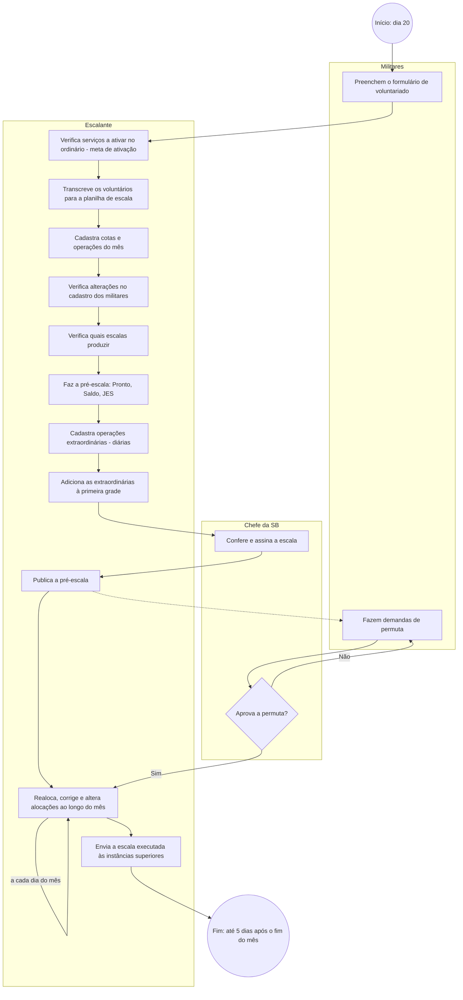

# Processo do mês — diagrama de atividades

Fonte: Diagrama de Atividades do claude.ai (v0.2, rascunho de 15/11/2026), colhido em 20/11/2026; a tabela de versões não veio (histórico no git). Quem cuida: DOCUMENTAÇÃO. As pontas soltas E1 a E7 seguem em aberto (a E8 foi respondida); a seção 4 foi refeita para o sistema novo em 25/11/2026.

## 1. Escopo

Este documento registra o **processo de montagem das escalas** do 2º GB (1ª SB), do disparo do formulário de voluntariado até o envio da escala executada às instâncias superiores. É o processo central: as saídas de outros processos viram entradas deste. Status: **rascunho v0.2**. O fluxo só tem o que o usuário informou; o que não foi confirmado está marcado como EM ABERTO.

- **Início:** dia 20 do mês anterior, quando é disparado o formulário de cadastro de voluntários para o mês seguinte.
- **Fim:** 5 dias após o fim do mês da escala.
- **Atores:**
  - **Militares:** preenchem o formulário de voluntariado e fazem as demandas de permuta.
  - **Escalante:** transcreve as respostas do formulário para a planilha de escala no formato esperado; monta, publica e mantém a escala.
  - **Chefe da SB:** confere e assina a escala após produzida; recebe as demandas de permuta e as aprova ou reprova.

## 2. Atividades por ator

Ordem conforme informada pelo usuário. Onde a ordem ou o responsável não foi confirmado, consta em "Observação" e na seção 5.

| # | Ator | Atividade | Observação |
|---|---|---|---|
| 1 | (dispara) | Dia 20: dispara o formulário de cadastro de voluntários para o próximo mês | Quem dispara: EM ABERTO (E1) |
| 2 | Militares | Preenchem o formulário de voluntariado | |
| 3 | Escalante | Verifica os serviços que precisam ser ativados no ordinário (meta de ativação) | |
| 4 | Escalante | Recebe a lista de voluntários e a transcreve para a planilha de escala, no formato esperado | Entrada: respostas do formulário |
| 5 | Escalante | Cadastra as cotas e as operações do mês | |
| 6 | Escalante | Verifica alterações no cadastro dos militares (adição, exclusão, afastamentos) | |
| 7 | Escalante | Verifica quais escalas precisarão ser produzidas | |
| 8 | Escalante | Faz a pré-escala (Pronto, Saldo, JES) | |
| 9 | Escalante | Cadastra as operações extraordinárias (diárias) | |
| 10 | Escalante | Adiciona as operações extraordinárias à primeira grade da escala | |
| 11 | Chefe da SB | Confere e assina a escala produzida | Em que ponto: EM ABERTO (E2) |
| 12 | Escalante | Publica a pré-escala | |
| 13 | Militares | Fazem demandas de permuta ao longo do mês | Momento: EM ABERTO (E3) |
| 14 | Chefe da SB | Recebe as demandas de permuta e as aprova ou reprova | |
| 15 | Escalante | Realoca, corrige, adiciona e altera alocações à medida que os dias passam | Repete ao longo do mês |
| 16 | Escalante | Ao fim do mês, envia às instâncias superiores a escala efetivamente executada | Prazo: até 5 dias após o fim do mês. Quem envia: EM ABERTO (E4) |

## 3. Diagrama

Raias por ator, na mesma ordem da tabela da seção 2. A seta tracejada indica ponto ainda EM ABERTO (seção 5).

## 4. Onde cada atividade toca o sistema novo (25/11/2026)

Cruzamento com a `main` depois da 7.5. Não muda o fluxo da seção 2, que é o que o usuário contou: mostra o que o escalante já faz no sistema e o que ainda faz por fora. O andamento está no [roadmap](../superpowers/plans/2026-11-16-roadmap-migracao.md); as regras, no [catálogo](regras/LEIAME.md).

| # | Atividade | No sistema novo | Situação |
|---|---|---|---|
| 1 | Disparo do formulário | O gestor abre a coleta do voluntariado do mês (RN-122); a tela inicial avisa os militares | Feito (7.1 e 7.2) |
| 2 | Militares preenchem o voluntariado | Meu voluntariado, na área pessoal (RN-39) | Feito (7.2) |
| 3 | Meta de ativação | Meta padrão e meta do dia, no Efetivo por dia (RN-108) | Feito |
| 4 | Transcrição dos voluntários | Deixa de existir para quem marca; o escalante lança por quem não marcou, e a correção do que o militar marcou fica no registro (RN-123) | Feito |
| 5 | Cotas e operações do mês | Tela Cotas; a diária é o próprio serviço (RN-33 a RN-35, RN-83) | Feito |
| 6 | Alterações no cadastro dos militares | Pecúlio (a SP), Habilitações na ficha da escala (a seção) e afastamentos (RN-135, RN-136) | Feito |
| 7 | Quais escalas produzir | Cadastro de Escalas, com os serviços de cada uma (RN-100) | Feito |
| 8 | Pré-escala | Pronto nos turnos e expediente do ADM; o Saldo e o JES do ADM à mão (RN-13, RN-20, RN-22) | Feito; a distribuição nas vagas e o JES do Pronto, fase 8 |
| 9–10 | Operações extraordinárias | Lançadas à mão na Escala do mês, com as cotas restantes à vista (RN-114) | Em parte: a distribuição pelas cotas é da fase 8 |
| 11 | Conferência e assinatura do Chefe | O gestor publica (RN-119); a assinatura fica fora do sistema (RN-27) | Em parte |
| 12 | Publicação | Estados da escala: prévia (unidade e as de baixo) e publicada (corporação) (RN-118) | Feito (7.3.1 a 7.5); o documento .xlsx, fase 8 |
| 13–14 | Permutas | Troca de dois ordinários na Grade geral; o registro da permuta e a busca por permutantes, fase 9 (RN-86 a RN-88) | Em parte |
| 15 | Realocações ao longo do mês | Mudança numa escala publicada abre a retificação; o turno que já começou só o gestor altera, com justificativa e registro (RN-85, RN-119, RN-120) | Feito |
| 16 | Envio da escala executada | Estado "remessada" existe; o botão de remessa e a escala executada, fase 9 | Fase 9 |

## 5. EM ABERTO

Pontos que não podem ser afirmados sem confirmação do usuário:

- **E1 — Disparo do formulário (dia 20):** no sistema novo, quem abre a coleta é o gestor da unidade (RN-122, decisão de 25/11/2026). Fica em aberto se o dia 20 continua sendo a data (a coleta não tem prazo automático).
- **E2 — Momento da assinatura do Chefe da SB:** no sistema novo, quem publica é o gestor (RN-119). Fica em aberto se a assinatura acompanha a publicação, a escala final ao fim do mês, ou as duas.
- **E3 — Permutas:** o diagrama as coloca depois da publicação da pré-escala; confirmar. Também não foi dito o que acontece quando o Chefe reprova (o desenho devolve ao militar, mas isso é suposição) nem quem registra a permuta aprovada na planilha (desenhado como Escalante, em "Realoca, corrige e altera").
- **E4 — Envio às instâncias superiores:** quem envia (Escalante ou Chefe da SB) e quais são as instâncias.
- **E5 — Ordem dos passos 3 a 7:** as verificações e cadastros foram listados nesta ordem pelo usuário; confirmar se a ordem é obrigatória ou se algum passo pode ocorrer em paralelo.
- **E6 — Desvios e exceções:** o diagrama cobre só o fluxo principal (militar não preenche o formulário, escala reprovada na conferência, voluntariado insuficiente para a meta de ativação etc. não foram descritos).
- **E7 — Processos vizinhos:** o usuário indicou que outros processos alimentam este; quais são e o que entregam não foi levantado.
- **E8 — Quem aprova a permuta:** respondida pela RN-88: o Chefe aprova fora do sistema, e o escalante registra só a troca já aprovada.
