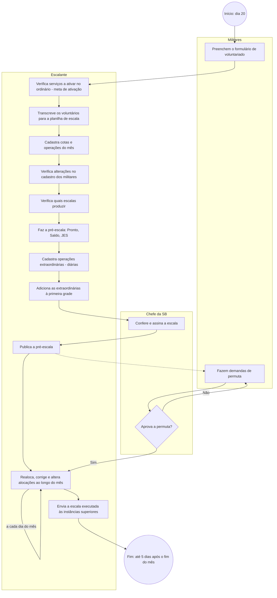

# Processo do mês — diagrama de atividades

Fonte: Diagrama de Atividades do claude.ai (v0.2, rascunho de 15/11/2026), colhido em 20/11/2026; a tabela de versões não veio (histórico no git). Quem cuida: REGRAS DE NEGÓCIO. As pontas soltas E1 a E8 seguem em aberto.

## 1. Escopo

Este documento registra o **processo de montagem das escalas** do 2º GB (1ª SB), do disparo do formulário de voluntariado até o envio da escala executada às instâncias superiores. É o processo central: as saídas de outros processos viram entradas deste. Status: **rascunho v0.2**. O fluxo só tem o que o usuário informou; o que não foi confirmado está marcado como EM ABERTO.

- **Início:** dia 20 do mês anterior, quando é disparado o formulário de cadastro de voluntários para o mês seguinte.
- **Fim:** 5 dias após o fim do mês da escala.
- **Atores:**
  - **Militares:** preenchem o formulário de voluntariado e fazem as demandas de permuta.
  - **Escalante:** transcreve as respostas do formulário para a planilha de escala no formato esperado; monta, publica e mantém a escala.
  - **Chefe da SB:** confere e assina a escala após produzida; recebe as demandas de permuta e as aprova ou reprova.

## 2. Atividades por ator

Ordem conforme informada pelo usuário. Onde a ordem ou o responsável não foi confirmado, consta em "Observação" e na seção 5.

| # | Ator | Atividade | Observação |
|---|---|---|---|
| 1 | (dispara) | Dia 20: dispara o formulário de cadastro de voluntários para o próximo mês | Quem dispara: EM ABERTO (E1) |
| 2 | Militares | Preenchem o formulário de voluntariado | |
| 3 | Escalante | Verifica os serviços que precisam ser ativados no ordinário (meta de ativação) | |
| 4 | Escalante | Recebe a lista de voluntários e a transcreve para a planilha de escala, no formato esperado | Entrada: respostas do formulário |
| 5 | Escalante | Cadastra as cotas e as operações do mês | |
| 6 | Escalante | Verifica alterações no cadastro dos militares (adição, exclusão, afastamentos) | |
| 7 | Escalante | Verifica quais escalas precisarão ser produzidas | |
| 8 | Escalante | Faz a pré-escala (Pronto, Saldo, JES) | |
| 9 | Escalante | Cadastra as operações extraordinárias (diárias) | |
| 10 | Escalante | Adiciona as operações extraordinárias à primeira grade da escala | |
| 11 | Chefe da SB | Confere e assina a escala produzida | Em que ponto: EM ABERTO (E2) |
| 12 | Escalante | Publica a pré-escala | |
| 13 | Militares | Fazem demandas de permuta ao longo do mês | Momento: EM ABERTO (E3) |
| 14 | Chefe da SB | Recebe as demandas de permuta e as aprova ou reprova | |
| 15 | Escalante | Realoca, corrige, adiciona e altera alocações à medida que os dias passam | Repete ao longo do mês |
| 16 | Escalante | Ao fim do mês, envia às instâncias superiores a escala efetivamente executada | Prazo: até 5 dias após o fim do mês. Quem envia: EM ABERTO (E4) |

## 3. Diagrama

Raias por ator, na mesma ordem da tabela da seção 2. A seta tracejada indica ponto ainda EM ABERTO (seção 5).

## 4. Onde cada atividade toca o sistema (estado em 15/11, do protótipo)

Cruzamento feito em 15/11 com o protótipo (P13 a P19). Não muda o fluxo: mostra o que o escalante já fazia pelo sistema e o que ainda fazia por fora. A situação no sistema novo está no [roadmap](../superpowers/plans/2026-11-16-roadmap-migracao.md).

| # | Atividade | No sistema hoje | Situação |
|---|---|---|---|
| 1 | Disparo do formulário | Nenhum registro de disparo pelo sistema | Fora do sistema |
| 3 | Meta de ativação | Abas GUARNIÇÕES e GUARNIÇÕES POR ESCALA (composição, mínimo, máximo, vínculo com vigência) | Cadastro feito; a ativação automática ainda não |
| 4 | Transcrição dos voluntários | Aba VOLUNTARIADO (DATA, MATRÍCULA, TURNO, SERVIÇO ACEITO) | Transcrição manual |
| 5 | Cotas e operações do mês | Aba COTAS (mês, serviço, quantidade, origem) | Feito (RN-33 a RN-35) |
| 6 | Alterações no cadastro dos militares | Aba MILITARES | Feito; afastamentos ainda sem aba |
| 7 | Quais escalas produzir | Aba ESCALAS e painel "Escalas de Serviço" | Feito; escala com N serviços (RN-100) |
| 8 | Pré-escala (Pronto, Saldo, JES) | Menu "Escala Automática": "Gerar Pronto" e "Gerar Adm" | Feito |
| 9–10 | Operações extraordinárias na grade | Menu "Escala Automática": "Gerar operações" (fase voluntária, depois compulsória) | Feito |
| 11 | Conferência e assinatura do Chefe | Nenhum registro: "quem assina" foi retirado do sistema (RN-27) | Fora do sistema |
| 12 | Publicação da pré-escala | Aba IMPRESSÃO (uma escala por mês); documentos da escala pedidos no RS-01 | Em parte |
| 13–14 | Permutas | Registro do par de permutantes (RN-86 a RN-88) e tela de permutas (RS-02) | A implementar; ver E8 |
| 15 | Realocações ao longo do mês | "Mostrar Grade Geral" e aba ESCALA, com bloqueio de choques e das regras da escala manual; "Conferir Integridade" | Feito; trava de dias passados a esclarecer (RN-85) |
| 16 | Envio da escala executada | Nenhum registro; a escala do dia (RS-01, B76) é corte por dia, não o envio mensal | Fora do sistema |

## 5. EM ABERTO

Pontos que não podem ser afirmados sem confirmação do usuário:

- **E1 — Disparo do formulário (dia 20):** quem dispara (Escalante? automático?). O diagrama parte do evento "dia 20" sem ator.
- **E2 — Momento da assinatura do Chefe da SB:** o usuário disse que ele confere e assina "após a escala produzida". Assina a pré-escala antes de publicar (como desenhado), a escala final ao fim do mês, ou ambas?
- **E3 — Permutas:** o diagrama as coloca depois da publicação da pré-escala; confirmar. Também não foi dito o que acontece quando o Chefe reprova (o desenho devolve ao militar, mas isso é suposição) nem quem registra a permuta aprovada na planilha (desenhado como Escalante, em "Realoca, corrige e altera").
- **E4 — Envio às instâncias superiores:** quem envia (Escalante ou Chefe da SB) e quais são as instâncias.
- **E5 — Ordem dos passos 3 a 7:** as verificações e cadastros foram listados nesta ordem pelo usuário; confirmar se a ordem é obrigatória ou se algum passo pode ocorrer em paralelo.
- **E6 — Desvios e exceções:** o diagrama cobre só o fluxo principal (militar não preenche o formulário, escala reprovada na conferência, voluntariado insuficiente para a meta de ativação etc. não foram descritos).
- **E7 — Processos vizinhos:** o usuário indicou que outros processos alimentam este; quais são e o que entregam não foi levantado.
- **E8 — Quem aprova a permuta:** o usuário disse em 14/11 que o Chefe da SB recebe as demandas de permuta e as aprova ou reprova; o catálogo (RN-88) diz que o registro pelo escalante já é a aprovação. As duas coisas podem conviver (o Chefe aprova fora do sistema e o escalante registra), mas isso não foi confirmado. Assunto para a REGRAS DE NEGÓCIO.
