# Esquema do banco — Sistema de Escalas 2º GB

16/11/2026 · v0.1 · parte do design (`2026-11-16-migracao-design.md`)

Em dia com as migrações até a `0034_postos_sem_bm.sql` (23/11/2026; quadros, escala dos oficiais, rastreio por dia, cadastro no tempo, participantes da rodada, as divisões, as camadas de visão, o abono e a função do militar e o posto sem "BM" nas suas seções). As tabelas das entregas 4.x estão na seção 9 e as mudanças da fase 5 (rastreio e CNH; ficha do Pecúlio), na seção 10.

Ponto de partida: o "ER proposto" do documento *Modelo ER — Sistema de Escalas 2º GB* (v0.8). Acréscimos: unidades em árvore, rastreio (lotação, equipe e jornada com vigência), vínculo de militar externo, usuários e papéis, modelos de impressão, documentos gerados e auditoria. Também entram as mudanças vindas dos esboços de tela (versão 12), que ainda podem mudar.

## Convenções

- **Banco:** PostgreSQL 15 ou superior (Supabase no teste, servidor do Estado depois). Extensões: `ltree` (caminho das unidades), `btree_gist` (impedir períodos sobrepostos), `pgcrypto` (`gen_random_uuid()`).
- **Nomes:** tabelas e colunas em português, minúsculas, sem acento, com `_`.
- **Chave primária:** `id uuid default gen_random_uuid()`. Exceção: `auditoria.id bigint` gerado, por ser uma tabela só de acréscimo e de grande volume.
- **Mês de referência:** coluna `date` sempre no dia 1 (`check (extract(day from x) = 1)`). Nos nomes, aparece como `vigencia_desde`, `mes` ou `desde`.
- **Períodos:** `desde date not null`, `ate date null` (null = em aberto). Sem sobreposição para a mesma chave, via `exclude using gist (... with =, daterange(desde, ate, '[]') with &&)`.
- **Vigência sem retroagir (RN-93):** criar uma versão com `vigencia_desde` anterior ao mês corrente é recusado pela API. Versões passadas não se editam.
- **Herança por unidade:** onde a regra diz "vale para a unidade e as de baixo", a unidade mais próxima na árvore vence (`unidade.caminho @> alvo.caminho`, ordenado pela profundidade, decrescente).
- **Regras de domínio fora do banco:** choque de horário, elegibilidade de JES, CNH por hierarquia, mínimo e máximo por função. Ficam no motor de regras (`pacotes/dominio`), que a API chama antes de gravar. O banco garante só a integridade (chaves, unicidade, períodos, valores permitidos).

## Diagrama

```mermaid
erDiagram
  tipo_unidade ||--o{ unidade : classifica
  unidade ||--o{ unidade : "mae de"
  unidade ||--o{ equipe : tem
  unidade ||--o{ rastreio : lota
  militar ||--o{ rastreio : "lotado em"
  equipe |o--o{ rastreio : agrupa
  quadro |o--o{ rastreio : "quadro em"
  situacao_militar ||--o{ rastreio : "situacao em"
  militar ||--o{ vinculo_externo : "externo em"
  unidade ||--o{ vinculo_externo : aceita
  posto_grad ||--o{ militar : classifica
  militar ||--o{ afastamento : tem
  tipo_afastamento ||--o{ afastamento : classifica
  atividade |o--o{ guarnicao : "feita por"
  militar ||--|| usuario : "e"
  usuario ||--o{ papel_usuario : tem
  unidade ||--o{ papel_usuario : "no ambito de"
  unidade ||--o{ servico : "dona de"
  servico ||--|{ turno : tem
  unidade ||--o{ funcao : cataloga
  unidade ||--o{ guarnicao : "dona de"
  guarnicao ||--|{ guarnicao_versao : versiona
  guarnicao_versao ||--o{ composicao : tem
  funcao ||--o{ composicao : "exigida em"
  unidade ||--o{ escala : "dona de"
  escala ||--|{ escala_servico : reune
  servico ||--o{ escala_servico : "entra em"
  escala ||--o{ escala_vinculo_versao : versiona
  escala_vinculo_versao ||--o{ escala_guarnicao : liga
  guarnicao ||--o{ escala_guarnicao : serve
  unidade ||--o{ cota : recebe
  servico ||--o{ cota : "cotado em"
  militar ||--o{ alocacao : tem
  militar ||--o{ remocao : "tirado de"
  escala ||--o{ alocacao : contem
  turno ||--o{ alocacao : "horario de"
  guarnicao |o--o{ alocacao : "vaga em"
  funcao |o--o{ alocacao : "funcao em"
  permuta ||--|{ permuta_item : troca
  alocacao ||--o| permuta_item : "trocada em"
  unidade ||--o{ parametro : define
  unidade ||--o{ feriado : define
  unidade ||--o{ modelo_impressao : usa
  modelo_impressao ||--o{ documento_gerado : gera
  alocacao ||--o{ alocacao_acumulo : acumula
  guarnicao ||--o{ alocacao_acumulo : "vaga extra em"
  funcao ||--o{ alocacao_acumulo : "funcao extra"
  militar ||--o{ voluntariado_lancamento : "lancado"
  militar ||--o{ disponibilidade : "pode em"
  escala ||--o{ ordem_escala_versao : versiona
  ordem_escala_versao ||--|{ ordem_escala_item : ordena
  guarnicao ||--o{ ordem_escala_item : "vez de"
  funcao ||--o{ ordem_escala_item : "vez de"
  unidade ||--o{ meta_padrao_versao : "meta padrao"
  meta_padrao_versao ||--o{ meta_padrao_item : lista
  unidade ||--o{ meta_dia : "dia diferente"
  meta_dia ||--o{ meta_dia_item : lista
  guarnicao ||--o{ meta_padrao_item : "ativada em"
  guarnicao ||--o{ meta_dia_item : "ativada em"
```

## 1. Estrutura e pessoas

### tipo_unidade
Tipos de unidade, em tabela para que um nível novo (ex.: pelotão) não exija mudar o esquema.

| Coluna | Tipo | Regra |
|---|---|---|
| codigo | text PK | `corporacao`, `diretoria_geral`, `diretoria_integrada`, `grupamento`, `divisao`, `secao` |
| nome | text not null | "Grupamento" |
| nivel | int not null | 0 a 5, ordem na árvore; único |

A **divisão** (nível 4, migração 0031) fica entre o grupamento (3) e a seção (5, antes 4). A unidade mãe precisa ser de nível acima do da filha: uma seção fica direto no grupamento ou dentro de uma divisão, e uma divisão não fica dentro de outra divisão nem de uma seção. A migração cria em cada grupamento, vazias, a Divisão Administrativa (`DA`) e a Divisão Operacional (`DivOp`); quais seções vão para cada uma decide o gestor do grupamento, na tela "Estrutura".

### unidade
| Coluna | Tipo | Regra |
|---|---|---|
| id | uuid PK | |
| tipo | text FK → tipo_unidade | |
| sigla | text not null | "2º GB", "1ª SB" |
| nome | text not null | "2º Grupamento de Bombeiros" |
| mae_id | uuid FK → unidade null | null só na raiz (CBMPE); uma única raiz |
| caminho | ltree not null, único | mantido por gatilho a partir de `mae_id`; índice gist |
| desde | date not null | mês de criação |
| ate | date null | mês de extinção |

Regra: o `nivel` do tipo da mãe é menor que o da filha.

### posto_grad
| Coluna | Tipo | Regra |
|---|---|---|
| id | uuid PK | |
| sigla | text único | "SD", "3º SGT", "ST" (sem "BM" desde a 0034) |
| nome | text | "Soldado" |
| ordem | int único | ordena por hierarquia (RN-101) |

### quadro
Fixo na migração (0026), como a hierarquia de CNH: QOC (ordem 1), QOA (2) e QBMG (3). O cadastro deles nas Configurações fica para quando o QOD for modelado.
| Coluna | Tipo | Regra |
|---|---|---|
| id | uuid PK | |
| sigla | text único | QOC, QOA, QBMG |
| nome | text | "Quadro de Oficiais Combatentes", "Quadro de Oficiais da Administração", "Qualificação Bombeiro Militar Geral" |
| ordem | int único | |
| oficial | boolean not null default false | quem está hoje neste quadro tem a camada de visão do oficial; QOC e QOA nascem `true` (migração 0032). O administrador marca e desmarca nas Configurações, e a mudança entra na auditoria |

### visao_bloco
A borda das camadas de visão (entrega 6.11, migração 0032): quais blocos de dados cada camada vê de um militar. Quem EDITA continua pela hierarquia (`papel_usuario`); aqui é só quem VÊ, e as camadas se somam. Vinte e uma linhas (sete blocos por três camadas), com a borda inicial da spec das camadas de visão; o administrador ajusta nas Configurações ("Quem vê o quê").
| Coluna | Tipo | Regra |
|---|---|---|
| id | uuid único | só serve à auditoria (a chave é a natural) |
| bloco | text | `identificacao`, `contato`, `situacao`, `afastamentos`, `dados_da_escala`, `comportamento`, `escala_em_montagem` |
| camada | text | `todos`, `oficial`, `chefe_divisao` |
| ve | boolean not null | a camada vê o bloco? |

PK `(bloco, camada)`. O banco recusa `identificacao`/`todos` com `ve = false` (sem a identificação a consulta não mostra nada). CPF, nascimento e endereço não são bloco: ficam de fora da borda, com regra fixa (quem tem nível de acesso acima da lotação do militar, o administrador e o próprio militar).

### quadro_posto_grad
Os postos-graduações de cada quadro (PK `quadro_id, posto_grad_id`); o mesmo posto pode estar em mais de um quadro. QOC: ASP OF, 2º TEN, 1º TEN, CAP, MAJ, TEN CEL e CEL. QOA: 2º TEN, 1º TEN, CAP e MAJ. QBMG: SD, CB, 3º SGT, 2º SGT, 1º SGT e ST. O ASP OF não aparece no QOD e entra no QOC (decisão de implementação).

### militar
| Coluna | Tipo | Regra |
|---|---|---|
| id | uuid PK | |
| matricula | text único | `^\d{6}-\d$` |
| posto_grad_id | uuid FK | |
| nome_completo | text null | obrigatório para militar novo (a API); vazio para quem já existia, e a ficha mostra a pendência "Nome completo em falta" (0024) |
| nome_guerra | text not null | |
| sexo | text null | `M` ou `F` (check; 0024) |
| nascimento_dia / nascimento_mes | smallint null | os dois juntos ou nenhum; o dia precisa existir no mês, e 29/02 vale sem o ano (check; 0024) |
| nascimento_ano | smallint null | opcional (D7 revista, 0029); só com dia e mês, de 1900 a 2100, e a data inteira precisa existir (check `militar_nascimento_ano_valido`) |
| cpf | text null | 11 dígitos (check) e único (índice `militar_cpf_unico`); os dígitos verificadores são conferidos pela API (0029) |
| cep | text null | 8 dígitos (check; 0029) |
| logradouro / numero / complemento / bairro / cidade | text null | texto livre, até 120 caracteres cada (0029) |
| uf | text null | uma das 27 siglas (check; 0029) |
| telefone | text null | texto livre curto (0024) |
| email | text null | institucional: só `@bombeiros.pe.gov.br`, sem distinção de maiúsculas (check) e único entre os militares (índice `militar_email_unico`, sobre `lower(email)`); pode ficar vazio (0024) |
| comportamento | text null | Excepcional, Ótimo, Bom, Insuficiente ou Mau (check; 0024) |
| comportamento_boletim | text null | boletim em que o comportamento foi publicado; texto livre curto (0024) |
| antiguidade | int null | ordem dentro do posto (RN-101); vazia vai por último |
| motorista | boolean not null default false | está no quadro de motoristas |
| cnh | text[] not null default '{}' | subconjunto de {A,B,C,D,E}, só as que constam na carteira. É do militar: pode estar gravada com `motorista = false`; para a escala só vale com `motorista = true` (regra do motor, `cnhParaEscala`). Até a 0022 havia um check que a exigia vazia fora do quadro; a 0023 o tirou |
| voluntario_jes | boolean not null default false | RN-46 |

O quadro e o "ativo" saíram do militar na 0029: valem por período, no `rastreio` (`quadro_id` e `situacao_id`). Nos testes e no CI, só CPF fictício com dígitos verificadores válidos.

A hierarquia de CNH (decisão de 18/11/2026, regra do CTB): A é uma categoria isolada: não habilita nenhuma outra e nenhuma outra a habilita. As demais seguem a cadeia B, C, D, E (regra do CTB): B habilita B; C habilita C e B; D habilita D e C (e, pela cadeia, B); E habilita E e D (e, pela cadeia, C e B). É regra de domínio, no código (RN-12; `CNH_HABILITA` em `pacotes/dominio/src/cnh.ts`). Não vai para tabela. TELEFONE não existe (D7).

### equipe
| Coluna | Tipo | Regra |
|---|---|---|
| id | uuid PK | |
| unidade_id | uuid FK | em geral uma seção |
| nome | text | "Alfa"; único por unidade |
| ordem_ciclo | int | posição no ciclo do Pronto; única por unidade |

### rastreio
O rastreio do militar: a lotação (a unidade), a equipe, a jornada, o quadro e a situação em cada período. A escala de março continua mostrando a situação de março. "Lotação" é só a unidade; o conjunto no tempo é o rastreio. A tabela se chamava `lotacao` até a 0022 (renomeada na 0023, com as mesmas colunas, índices e regras).

| Coluna | Tipo | Regra |
|---|---|---|
| id | uuid PK | |
| militar_id | uuid FK | |
| unidade_id | uuid FK | |
| equipe_id | uuid FK null | equipe da mesma unidade (gatilho) |
| jornada | text not null | `pronto` ou `adm` |
| quadro_id | uuid FK null | o quadro no período (0029); nulo passa e a ficha mostra a pendência "Sem quadro". Que o posto pertence ao quadro é regra da API (o posto não tem histórico): ela escolhe o quadro quando ele não vem, o atual se contém o posto, senão o do posto se for um só |
| situacao_id | uuid FK not null | a situação no período, do catálogo `situacao_militar` (0029); sem valor na inclusão, o gatilho `rastreio_situacao_padrao` põe "Ativa" |
| desde | date not null | qualquer dia (o rastreio vale por dia, como os afastamentos; até a 0027 era o dia 1 do mês) |
| ate | date null | inclusive; o período seguinte começa no dia depois |

Regra: sem períodos sobrepostos por militar (exclude gist).

### situacao_militar
Catálogo do sistema, editado só pelo administrador (0029). Carga inicial: Ativa (pode ser escalado), Reserva, Agregado, Adido e Desativado (não podem). Com auditoria.

| Coluna | Tipo | Regra |
|---|---|---|
| id | uuid PK | |
| nome | text not null | único sem distinção de maiúsculas |
| escalavel | boolean not null | quem está nesta situação pode ser escalado (substitui o antigo `militar.ativo`) |
| ativo | boolean not null default true | desativada, sai da lista de escolha e fica nos registros antigos |
| padrao | boolean not null default false | a situação dos períodos novos ("Ativa" na carga); uma só (índice único parcial). Pode ser renomeada, mas a API não deixa desativá-la nem tirar o "pode ser escalado" |

### vinculo_externo
Militar de outra unidade autorizado a tirar serviço aqui.

| Coluna | Tipo | Regra |
|---|---|---|
| id | uuid PK | |
| militar_id | uuid FK | |
| unidade_id | uuid FK | unidade que aceita o militar |
| desde / ate | date | sem sobreposição por (militar, unidade) |
| observacao | text null | |

Elegibilidade (domínio): um militar pode ser alocado numa escala se, na data, tem lotação na unidade da escala **ou** um vínculo externo ativo com ela. Na lista "Escolher militar", os externos aparecem depois dos lotados e marcados como externos.

### afastamento
| Coluna | Tipo | Regra |
|---|---|---|
| id | uuid PK | |
| militar_id | uuid FK | |
| tipo_afastamento_id | uuid FK | tipo do catálogo do sistema (sem motivo de saúde; D7) |
| inicio / fim | date | `fim >= inicio`; sem sobreposição por militar; qualquer intervalo, inclusive férias em partes |
| motivo | text null | até 200 caracteres (check); a tela avisa "Não escreva diagnóstico." (D7; 0024) |
| boletim | text null | até 60 caracteres (check): o boletim que publicou o afastamento (0024) |

Regra (domínio): no período, o militar não aparece como opção em nenhuma vaga.

### tipo_afastamento
Catálogo do sistema todo (é institucional), editado pelo administrador na tela de Configurações (adendo de 17/11/2026, fase 3). Vem com Férias, LTS, Curso e Outro (0009) e Adido, Agregado, L.E e DTS (0024, criados sem duplicar).

| Coluna | Tipo | Regra |
|---|---|---|
| id | uuid PK | |
| nome | text | único |
| ativo | boolean | desativado não aparece para lançar, mas continua nos afastamentos antigos |

## 2. Usuários e papéis

### usuario, sessao, conta e verificacao

As tabelas de login são do Better Auth (D3): `usuario`, `sessao`, `conta` e `verificacao`, com os nomes configurados em português. Acréscimos na tabela `usuario`:

| Coluna | Tipo | Regra |
|---|---|---|
| militar_id | uuid FK, único, not null | todo usuário é um militar |
| ativo | boolean default true | |
| senha_provisoria_ate | timestamptz null | `null` = senha definitiva; com data, é a senha provisória e vale até ela (7 dias; migração 0025) |

O e-mail do `usuario` é o da ficha do militar: o gatilho `militar_email_para_usuario` (0025) copia `lower(militar.email)` para `usuario.email` quando o e-mail da ficha muda, e barra apagar o e-mail de quem tem acesso ativo (`email_obrigatorio_com_acesso`).

### papel_usuario
| Coluna | Tipo | Regra |
|---|---|---|
| id | uuid PK | |
| usuario_id | uuid FK | |
| unidade_id | uuid FK | o papel vale para a unidade e as de baixo |
| papel | text | `administrador` (só na unidade raiz; superusuário), `gestor` (antigo `chefe`), `chefe_divisao` (só numa unidade do tipo `divisao`; migração 0031), `escalante` |
| desde / ate | date | |

O gatilho `papel_chefe_divisao` (0031) recusa o `chefe_divisao` numa unidade que não é divisão, com "Chefe de divisão só existe numa divisão.", como o `papel_administrador` faz com o administrador fora da raiz. O chefe de divisão edita como o gestor na sua divisão e nas seções de dentro; quem dá o nível é o gestor de uma unidade acima da divisão ou o administrador.

O **militar comum** não tem linha nesta tabela: é o usuário sem papel vigente. Ele vê os próprios serviços (com quem compõe cada guarnição) e as escalas publicadas da unidade da lotação dele, e não vê cadastros (adendo de 17/11/2026).

A tabela `convite`, que nunca teve uso, saiu na migração 0025: o acesso nasce da senha provisória gerada na ficha.

Não existe cadastro aberto. O primeiro administrador é criado por um comando de instalação.

## 3. Serviços, turnos e funções

### servico
| Coluna | Tipo | Regra |
|---|---|---|
| id | uuid PK | |
| unidade_id | uuid FK | dona |
| nome | text | único por unidade |
| tipo | text | `ordinario`, `pjes`, `diaria` (o expediente do Adm é `ordinario`) |
| operacao | text null | só quando `tipo = 'diaria'` (check; RN-83) |
| rotulo_impressao | text null | antiga coluna ORIGEM (B49); vazio = nome |
| cor | text | hex `#RRGGBB`, usada nos blocos da grade e nas etiquetas |
| ativo | boolean | |
| fixo | boolean | `default false`; definido por gatilho pelo nome (migração 0020). Pronto, Saldo e Expediente são `ordinario` e JES é `pjes`; num serviço fixo o nome, o tipo e a situação não mudam |

### turno
| Coluna | Tipo | Regra |
|---|---|---|
| id | uuid PK | |
| servico_id | uuid FK | |
| letra | text | "A", "B" ou "C"; única por serviço (sem "U" desde a 0011: o turno único é o A) |
| inicio / fim | time | `fim < inicio` atravessa a meia-noite; `fim = inicio` é um turno de 24h; a duração é calculada |

Regra de exibição: o turno aparece no dia em que começa. O dia de serviço vai das 08h de D às 08h de D+1 (efetivo do dia).

Regra (domínio, adendo de 17/11/2026): o turno não tem ligação cadastrada com o turno padrão do voluntariado. Vale o **horário**: o militar precisa ter marcado **todo** turno padrão que o turno do serviço toca. A de D = 08h às 20h de D; B de D = 20h de D às 08h de D+1. Exemplos: 08h às 16h pede A de D; 16h às 00h pede A e B de D; 00h às 08h pede B de D−1; 07h às 19h pede B de D−1 e A de D; 24h a partir das 08h pede A e B de D. Desde a migração 0018 o militar marca faixas de horário (`disponibilidade`, seção 9), não o turno padrão A/B.

### atividade
O que a guarnição faz (Incêndio, APH, Salvamento, Incêndio em vegetação, Apoio operacional…). Não confundir com **serviço**, que é de onde vem a hora (Pronto, PJES, Saldo, Diária). Catálogo do sistema todo, editado pelo administrador na tela de Configurações.

| Coluna | Tipo | Regra |
|---|---|---|
| id | uuid PK | |
| nome | text | único |
| ativo | boolean | |

### funcao
| Coluna | Tipo | Regra |
|---|---|---|
| id | uuid PK | |
| unidade_id | uuid FK | catálogo da unidade (RN-94); herdado pelas de baixo |
| nome | text | "Motorista", "Chefe", "Socorrista"; único por unidade |

Quais funções um serviço usa não é cadastrado: sai das guarnições ligadas às escalas do serviço (decidido em 17/11/2026).

## 4. Guarnições

### guarnicao
| Coluna | Tipo | Regra |
|---|---|---|
| id | uuid PK | |
| unidade_id | uuid FK | dona; pode ser seção ou GB |
| nome | text | único por unidade |
| atividade_id | uuid FK null | sem uso desde a entrega 3.1: a guarnição é um modelo, sem atividade (17/11/2026) |

A guarnição é definida pela atividade e pela composição (funções com mínimo, máximo e CNH). Cada guarnição é um card na escala; não há agrupamento de cards (decidido em 17/11/2026). Ela pode servir a mais de uma escala.

### guarnicao_versao
| Coluna | Tipo | Regra |
|---|---|---|
| id | uuid PK | |
| guarnicao_id | uuid FK | |
| vigencia_desde | date | dia 1; único por guarnição; sem retroagir |
| viatura | text null | sigla, opcional (RN-96); só informativa |
| tipo_viatura | text null | "Auto Resgate"; só informativo |
| prioridade | int null | ordem de ativação (RN-08); vazia vai por último (Q18) |
| ativa | boolean | RN-07 |

Vale, para um mês, a versão com o maior `vigencia_desde <= mês`.

A viatura é útil na tela e no documento, mas **não é fonte de regra**: a viatura usada muda no dia e durante o serviço, há guarnição sem viatura, e a mesma viatura serve a atividades diferentes (a ABSL sai numa guarnição de incêndio em vegetação ou numa de salvamento). Mínimo e máximo vêm só da composição.

### composicao
| Coluna | Tipo | Regra |
|---|---|---|
| id | uuid PK | |
| guarnicao_versao_id | uuid FK | |
| funcao_id | uuid FK | única por versão |
| minimo | int not null | `>= 0` (RN-10) |
| maximo | int not null | `>= minimo` (RN-11); vazio na planilha vira o mínimo (migração 0010, 17/11/2026) |
| cnh_exigida | text null | uma letra A a E; atendida pela hierarquia (RN-12) |
| ordem | int | ordem das linhas na tela e no documento |

Vagas obrigatórias = `minimo`; vagas acima do mínimo = `maximo - minimo` (sem rótulo na tela).

## 5. Escalas

### escala
| Coluna | Tipo | Regra |
|---|---|---|
| id | uuid PK | |
| unidade_id | uuid FK | dona; seção ou nível acima |
| nome | text | único por unidade |
| titulo | text | título no documento |
| militares_doc | text | `todos` ou `escalados` |
| dias_doc | text | `todos` ou `com_escalados` |
| ativa | boolean | |
| monta_blocos_voluntariado | boolean | `default true`; se os blocos do dia do voluntariado são montados pelos horários desta escala (migração 0019) |

### escala_servico
Troca a lista em texto `ESCALAS.SERVIÇOS` (RN-100).

| Coluna | Tipo | Regra |
|---|---|---|
| escala_id | uuid FK | PK composta |
| servico_id | uuid FK | PK composta |
| ordem | int | ordem de preenchimento (Pronto, então JES, então Saldo; RN-13); única por escala |

### escala_vinculo_versao e escala_guarnicao
Quais guarnições servem cada turno da escala, com vigência (RN-09, RN-93).

| escala_vinculo_versao | Tipo | Regra |
|---|---|---|
| id | uuid PK | |
| escala_id | uuid FK | |
| vigencia_desde | date | único por escala; sem retroagir |

| escala_guarnicao | Tipo | Regra |
|---|---|---|
| id | uuid PK | |
| versao_id | uuid FK | |
| guarnicao_id | uuid FK | |
| inicio | time | faixa de horário do turno (desde a 0011; antes, `turno_letra`) |
| fim | time | |

Único por (versao_id, guarnicao_id, inicio, fim). A faixa vale para todo serviço da escala com um turno nesse horário. Não há "todos os turnos".

## 6. O mês

### cota
| Coluna | Tipo | Regra |
|---|---|---|
| id | uuid PK | |
| mes | date | dia 1 |
| unidade_id | uuid FK | quem recebe |
| servico_id | uuid FK | serviço de tipo `pjes` ou `diaria` (não há cota de ordinário) |
| quantidade | int | `> 0` |
| origem | text | `interna` ou `externa` (RN-35) |
| prioridade | int | 1 é preenchida primeiro |

A operação deixa de existir na cota (resolve Q14): ela é atributo do serviço do tipo diária.

### voluntariado (removida)

A tabela `voluntariado` (dia e turno padrão A/B) foi apagada pela migração 0018. A disponibilidade passou para faixas de horário em `disponibilidade`, e o registro de que o mês foi lançado está em `voluntariado_lancamento` (seção 9). As "pedidas" da grade geral contam, por tipo (PJES, Diária), os horários marcados; um voluntário JES conta nos dois tipos, os demais só em Diária.

### alocacao
Fonte da verdade da escala.

| Coluna | Tipo | Regra |
|---|---|---|
| id | uuid PK | |
| militar_id | uuid FK | |
| escala_id | uuid FK | |
| servico_id | uuid FK | serviço da escala (gatilho: está em `escala_servico`) |
| turno_id | uuid FK | turno do serviço (gatilho) |
| data | date | dia em que o turno começa |
| guarnicao_id | uuid FK null | vaga ocupada; null = sem posto |
| funcao_id | uuid FK null | |
| origem | text | `pre_escala`, `distribuicao`, `manual`, `permuta` |
| presente | boolean null | marcação de presença no efetivo do dia |
| presenca_por / presenca_em | uuid FK / timestamptz null | |

Único por (militar_id, data, servico_id, turno_id), a chave atual da P13. A elegibilidade (lotação ou vínculo externo, afastamento, voluntário JES, CNH, choque) é verificada pelo motor antes de gravar.

### remocao
Militar tirado pelo escalante de um dia, serviço e turno (adendo de 17/11/2026). A pré-escala e as distribuições não o colocam de volta nessa combinação.

| Coluna | Tipo | Regra |
|---|---|---|
| id | uuid PK | |
| militar_id | uuid FK | |
| escala_id | uuid FK | escala de onde foi tirado |
| servico_id | uuid FK | |
| turno_id | uuid FK | |
| data | date | dia em que o turno começa |
| removida_por | uuid FK → usuario null | |
| removida_em | timestamptz | |

Único por (militar_id, data, servico_id, turno_id), a mesma chave da alocação. Remover = apagar a alocação e gravar a remoção na mesma transação. Uma alocação nova com a mesma chave apaga a remoção (gatilho), o que também serve de "Desfazer remoção".

### permuta e permuta_item
Só a troca já aprovada (E8): o escalante registra depois da aprovação do Chefe, feita fora do sistema.

| permuta | Tipo | Regra |
|---|---|---|
| id | uuid PK | |
| mes | date | as duas alocações são do mesmo mês (RN-87) |
| registrada_por | uuid FK → usuario | |
| registrada_em | timestamptz | |
| observacao | text null | |

| permuta_item | Tipo | Regra |
|---|---|---|
| id | uuid PK | |
| permuta_id | uuid FK | exatamente 2 itens por permuta (RN-86) |
| alocacao_id | uuid FK, único | a alocação passa a ter o substituto em `militar_id` |
| militar_original_id | uuid FK | quem estava escalado; o efetivo do dia mostra "no lugar de" |

## 7. Configurações e documentos

### parametro
| Coluna | Tipo | Regra |
|---|---|---|
| id | uuid PK | |
| chave | text | catálogo fixo no código: `CARGA_MENSAL_HORAS`, `SALDOS_ADM_POR_MILITAR`, `ADM_CUMPRE_CARGA` (`LINHAS_POR_MILITAR` era da planilha e não vem para o sistema novo) |
| unidade_id | uuid FK | vale para a unidade e as de baixo |
| vigencia_desde | date | dia 1 |
| valor | jsonb | validado por chave na API |
| norma_referencia | text null | ex.: portaria ou PCG |

Único por (chave, unidade_id, vigencia_desde). Valor para (chave, unidade U, mês M): a unidade mais próxima de U na árvore que tenha a chave, na maior vigência `<= M`. `SECAO_PADRAO` sai: o seletor de unidade substitui.

### feriado
| Coluna | Tipo | Regra |
|---|---|---|
| id | uuid PK | |
| unidade_id | uuid FK | nacional e estadual no CBMPE; municipal na unidade da cidade |
| data | date | única por unidade |
| descricao | text | |
| fixo | boolean default true | cai no mesmo dia todo ano; "Copiar feriados fixos" copia só estes (Carnaval e Paixão ficam `false`) |

Um dia é feriado para U se houver feriado em U ou em qualquer unidade acima.

### modelo_impressao
| Coluna | Tipo | Regra |
|---|---|---|
| id | uuid PK | |
| unidade_id | uuid FK | herdado pelas de baixo |
| documento | text | `escala_publicada`, `efetivo_dia`, `escala_executada` |
| versao | int | sequencial por (unidade, documento) |
| arquivo | bytea | o .xlsx enviado |
| marcadores | jsonb | marcadores encontrados na conferência do envio |
| enviado_por / enviado_em | | |

O modelo vigente é a maior versão. Na escala, o modelo usado é o do documento `escala_publicada` herdado pela unidade da escala.

### documento_gerado
| Coluna | Tipo | Regra |
|---|---|---|
| id | uuid PK | |
| documento | text | como em `modelo_impressao` |
| unidade_id | uuid FK | |
| escala_id | uuid FK null | |
| referencia | date | mês (escala) ou dia (efetivo) |
| modelo_id | uuid FK | versão do modelo usada |
| xlsx | bytea | |
| pdf | bytea null | null se o serviço de PDF falhou ou ainda não existe |
| gerado_por / gerado_em | | |

Cada publicação e cada retificação ficam guardadas.

## 8. Auditoria

### auditoria
| Coluna | Tipo | Regra |
|---|---|---|
| id | bigint gerado PK | |
| em | timestamptz default now() | |
| usuario_id | uuid null | lido de `current_setting('app.usuario_id', true)`; null = carga ou manutenção |
| unidade_id | uuid null | unidade do registro alterado (direta ou pela escala/militar) |
| tabela | text | |
| registro_id | text | |
| acao | text | `insert`, `update`, `delete` |
| antes / depois | jsonb null | |

- **Gravada pelo banco:** um gatilho genérico em todas as tabelas das seções 1 a 7 (menos as de sessão do Better Auth).
- **Só acréscimos:** o papel da aplicação não tem `update` nem `delete` na tabela, e um gatilho recusa as duas operações mesmo para quem tiver.
- **Usuário:** a API abre cada transação com `set local app.usuario_id = '<id>'`.
- **Índices:** (unidade_id, em) e (tabela, registro_id).

## 9. Acréscimos das entregas 4.x (migrações 0015 a 0022)

Tabelas criadas depois do esquema original. Todas têm o gatilho de auditoria da seção 8. As entregas citadas seguem a numeração do roadmap.

### alocacao_acumulo

Acúmulo de funções (migração 0015, entrega 1.1): um militar já escalado ocupa também outra vaga, inclusive de outra guarnição. Não é uma segunda alocação: o banco já impede duas alocações do mesmo militar no mesmo turno, e as horas contam uma vez só. Apagar a alocação apaga os acúmulos.

| Coluna | Tipo | Regra |
|---|---|---|
| alocacao_id | uuid FK | a alocação que acumula; `on delete cascade` |
| guarnicao_id | uuid FK | guarnição da vaga extra |
| funcao_id | uuid FK | função da vaga extra |

Única por (alocacao_id, guarnicao_id, funcao_id).

### voluntariado_lancamento

Marca que o escalante lançou o voluntariado de um militar num mês (migração 0016, entrega 2). Um lançamento sem marcação também conta ("já lançado, 0 dias"); por isso é um registro à parte.

| Coluna | Tipo | Regra |
|---|---|---|
| militar_id | uuid FK | |
| mes | date | dia 1 |
| lancado_por | uuid FK → usuario null | |
| lancado_em | timestamptz | `not null default now()` |

Único por (militar_id, mes).

### disponibilidade

Faixas de horário em que o militar pode, por dia (migração 0018, entrega 2.2). Substitui o turno padrão A/B. Guarda-se o horário, não a letra do bloco, para a tela poder mudar sem refazer dados.

| Coluna | Tipo | Regra |
|---|---|---|
| militar_id | uuid FK | |
| data | date | |
| inicio_min, fim_min | int | minutos do dia; 0 ≤ início < fim ≤ 1440 |
| origem | text | `manual`, `importacao` ou `militar` |

Única por (militar_id, data, inicio_min).

### ordem_escala_versao e ordem_escala_item

A ordem de escala (migração 0017, entrega 2.1): uma lista por escala, com vigência por mês, da vez de cada vaga. Substitui a prioridade da guarnição como regra de quem é preenchido primeiro.

| Coluna | Tipo | Regra |
|---|---|---|
| ordem_escala_versao.escala_id | uuid FK | |
| ordem_escala_versao.vigencia_desde | date | dia 1; única por escala |
| ordem_escala_item.id | uuid | único; serve só à auditoria (a chave é versão + posição) |
| ordem_escala_item.versao_id | uuid FK | `on delete cascade`; PK com `posicao` |
| ordem_escala_item.posicao | int | 1 em diante: a vez |
| ordem_escala_item.guarnicao_id, funcao_id | uuid FK | |
| ordem_escala_item.vaga | int | número da vaga; único por (versão, guarnição, função, vaga) |

### meta_padrao_versao, meta_padrao_item, meta_dia e meta_dia_item

A meta de ativação (migração 0022, entrega 3.2.2): a lista de guarnições que a seção quer ativar num dia, na ordem de ativação. A meta padrão vale de uma data em diante (uma versão por data); um dia diferente tem lista própria, que pode ser vazia (dia sem meta) e vale no lugar do padrão.

| Coluna | Tipo | Regra |
|---|---|---|
| meta_padrao_versao.unidade_id, desde | uuid FK, date | única por (unidade, desde) |
| meta_dia.unidade_id, data | uuid FK, date | única por (unidade, data) |
| meta_*_item.versao_id / meta_dia_id | uuid FK | `on delete cascade` |
| meta_*_item.guarnicao_id | uuid FK | única por lista |
| meta_*_item.ordem | int | 1 em diante; única por lista |

### Onde mora cada restrição

| Restrição | Onde fica |
|---|---|
| Composição | na vaga da guarnição (função, mínimo e máximo, CNH) |
| Vinculação | na ligação guarnição × serviço, com a vez de cada serviço |
| Horário | no turno do serviço (início e fim) |
| Prestação de contas | na cota da fonte (mês e quantidade) |

Fonte: "ER da meta de ativação" do claude.ai (20/11/2026), colhido em 20/11/2026.

## 10. Fase 5, entrega 1: rastreio e CNH (migração 0023)

- **`lotacao` virou `rastreio`** (`alter table ... rename`): mesmas colunas, restrição de não sobrepor e gatilho de equipe da mesma unidade (índices, restrições e o gatilho `rastreio_equipe` ganharam o nome novo). A auditoria continua ligada à tabela, e `registrar_auditoria()` foi recriada para achar a unidade do militar pelo rastreio mais recente. Linhas de auditoria antigas continuam com `tabela = 'lotacao'`.
- **Sai o check `motorista or cardinality(cnh) = 0` de `militar`:** a CNH é do militar, esteja ou não no quadro de motoristas. Quem decide o que vale para a escala é o motor (`cnhParaEscala`: com `motorista = false`, a CNH não vale).
- **As sete seções do 2º GB:** a migração cria 2ª a 7ª SB (tipo `secao`, mãe o 2º GB, `desde` do 2º GB) quando ainda não existem, pela sigla. A 1ª SB já existia.
- A migração confere cada passo antes de mudar e pode rodar de novo (ambiente já migrado à mão).

### Fase 5, entrega 2: ficha do Pecúlio (migração 0024)

- **`militar` ganha** `nome_completo`, `sexo`, `nascimento_dia` e `nascimento_mes` (sem o ano, D7), `telefone`, `email`, `comportamento` e `comportamento_boletim`, todos opcionais no banco, com as regras descritas na tabela da seção `militar` (checks de sexo, nascimento, e-mail institucional e comportamento; índice único do e-mail sem distinção de maiúsculas).
- **`afastamento` ganha** `motivo` (até 200) e `boletim` (até 60).
- **`tipo_afastamento`:** Adido, Agregado, L.E e DTS entram no catálogo, uma vez só (LTS já existia).
- **Dono por bloco** (regra da API, sem coluna nova): os blocos do Pecúlio (identificação, dados pessoais, contato, comportamento, afastamentos, criar militar e a mudança de **lotação**) são de quem tem papel de cadastro numa unidade **acima** da lotação atual do militar; equipe, jornada, quadro de motoristas, CNH e voluntário JES são de quem tem papel na lotação ou acima. A ficha devolve `podeEditar` com o resultado.
- A migração confere cada passo antes de mudar e pode rodar de novo.

### Entrega paralela P1.2: escala dos oficiais (migração 0027)

Quatro tabelas, todas com auditoria (a função `registrar_auditoria` ganhou um ramo que acha a unidade pelo `mes_id`):

- **`oficiais_mes`:** um mês por unidade (`unique (unidade_id, mes)`, `mes` é o dia 1). `servico_id` é o serviço do oficial de operações, escolhido por mês (nulo até a escolha; vem copiado do último mês e só muda antes das cotas); os turnos e os horários vêm dele. `ordem_manual uuid[]` guarda a ordem à mão dos oficiais sem antiguidade; `cotas_em`, `fechada_em` e `encerrada_em` marcam as etapas (checks: calcular exige o serviço; fechar exige cotas; encerrar exige fechada).
- **`oficiais_cota`:** a cota gravada no último "Calcular cotas" (PK `mes_id, militar_id`; `unique (mes_id, ordem)`): `dias` presentes, `devido numeric(12,6)`, `cota` e `sobra`. O `id` só serve à auditoria.
- **`oficiais_turno`:** um registro por dia e por turno do serviço (`turno_id` → `turno`), com `militar_id` (vazio = turno sem nome) e `saiu_militar_id` (a cobertura: quem saiu, só com a escala fechada). `unique (mes_id, dia, turno_id)`; a API garante que o turno é do serviço do mês.
- **`oficiais_saldo`:** os lançamentos do saldo por unidade e oficial: `mes` (calculado no encerramento, com tirado, devido e a contagem de turnos por rótulo: `turnos_dia` e `turnos_noite`, o rótulo vindo do horário de início do turno), `entrada` (média de quem chega) e `ajuste` (do gestor, com `motivo` de 1 a 200 caracteres e o `usuario_id`). Um `mes` e uma `entrada` por oficial e mês (índice único parcial). O saldo acumulado é a soma de `valor`.

### Fase 6, entrega 5: rastreio por dia (migração 0028)

- **`rastreio.desde` aceita qualquer dia:** a migração tira a regra "dia 1" do `rastreio` (acha a regra pelo que ela diz, em `pg_constraint`; a da `unidade` fica). Os períodos que já começam no dia 1 não mudam, e a regra de não sobrepor continua.
- **"Alterar situação"** (`POST /api/militares/:id/situacao`) recebe `desde` como data: no dia do período aberto, ele é substituído; depois, o período aberto termina no dia anterior; antes, 400 com "Use o dia do período aberto ou um dia depois.".
- **Um militar, uma situação por mês nas listas e na ficha:** com dois períodos no mesmo mês, valem o de hoje (mês de hoje), o do primeiro dia (mês futuro) ou o do último (mês passado). A Grade mostra duas linhas (uma por período, cada uma só nos dias dele), e a escolha de militar e a pré-escala usam o período de cada dia.

### Fase 6, entrega 9: cadastro no tempo (migração 0029)

- **Quadro e situação por período:** `rastreio` ganha `quadro_id` e `situacao_id`; a migração copia o quadro e o "ativo" de cada militar para todos os períodos dele ("ativo" vira Ativa; o resto, Desativado) e só então tira `militar.quadro_id`, `militar.ativo` e a FK composta `militar_posto_no_quadro`.
- **`situacao_militar`:** o catálogo das situações, com `escalavel`. As escalas, a Grade, o Voluntariado e a escala dos oficiais leem o quadro e a situação do período de cada dia.
- **"Alterar situação"** (`POST /api/militares/:id/situacao`) aceita `quadroId` e `situacaoId` (de quem cuida do Pecúlio); omitidos, o período novo repete os do atual. Trocar o posto ajusta o quadro do período aberto (no lugar, se começou hoje; senão fecha na véspera e abre outro).
- **Dados pessoais (D7 revista):** `militar` ganha `cpf`, `nascimento_ano` e o endereço (`cep`, `logradouro`, `numero`, `complemento`, `bairro`, `cidade`, `uf`).
- A migração confere cada passo antes de mudar e pode rodar de novo.

### Entrega paralela P1.5: quem participa da rodada (migração 0030)

- **`oficiais_participante`:** quem o gestor marcou para a rodada do mês (PK `mes_id, militar_id`; `mes_id` → `oficiais_mes` com `on delete cascade`; com auditoria). Ser QOC ou QOA, com situação que deixa escalar e período na unidade ou abaixo dela, torna o oficial **elegível**; só quem está marcado entra nas cotas, na vez de escolher e nos turnos.
- **Mês novo:** as marcas vêm copiadas do mês anterior da unidade quando o mês é gravado; no primeiro mês da unidade, ninguém vem marcado. A API devolve `novo` para o elegível que não era elegível no mês anterior.
- **Carga:** nos meses que já existiam, participa quem tem cota; no mês gravado ainda sem cotas, todo elegível (a regra de antes). Um mês que já tem alguma marca não é recarregado. A migração pode rodar de novo.

### Fase 6, entrega 15: abono, função e posto sem BM (migrações 0033 e 0034)

- **`funcao_militar`:** o catálogo das funções do militar (`id`, `nome` com índice único sem diferenciar maiúsculas, `ativo`); com auditoria. Só o administrador inclui, renomeia e desativa; desativar tira a função da escolha, mas ela continua nas fichas que já a têm.
- **`militar`** ganha `funcao_militar_id` (FK para `funcao_militar`, vazia para quem não tem função) e `abono_permanencia` (`boolean not null default false`). Só quem cuida do Pecúlio altera os dois, pela ficha e pelas colunas FUNÇÃO e ABONO DE PERMANÊNCIA da planilha.
- **`posto_grad.sigla` sem o sufixo " BM"** (0034): tira o " BM" de cada sigla, exceto quando já existe um posto com a sigla resultante. As migrações antigas (0007 e 0026) continuam como estavam, e o motor aceita as duas formas ao ordenar. A migração pode rodar de novo.

## Mudanças em relação ao ER proposto (v0.8)

**Entram**
- Unidades em árvore (`tipo_unidade`, `unidade`).
- `rastreio` (antes `lotacao`) com vigência, `equipe` e jornada por período.
- `vinculo_externo`.
- Usuários, `papel_usuario`, `convite`.
- Na escala: `escala_vinculo_versao` e `escala_guarnicao`.
- No serviço: `cor` e `rotulo_impressao`.
- No militar: `motorista` separado de `cnh` em conjunto.
- Na alocação: presença, origem, guarnição e função.
- `permuta_item` com o militar original.
- `remocao` (adendo de 17/11/2026).
- `tipo_afastamento` e `atividade`, catálogos do sistema; `guarnicao.atividade_id`; `feriado.fixo` (adendo de 17/11/2026, fase 3).
- No parâmetro: `norma_referencia` e unidade.
- No feriado: unidade.
- `modelo_impressao`, `documento_gerado`, `auditoria`.

**Mudam**
- `afastamento` com tipo genérico.
- `voluntariado` por dia e turno padrão (A ou B), sem serviço, com origem (depois trocado por `disponibilidade`, migração 0018).
- `cota` sem operação, apontando para unidade e serviço.
- `funcao` como catálogo por unidade.

**Saem**
- `TURNOS.ID` e `SERVIÇO_FK` (resolve Q3).
- A lista em texto `ESCALAS.SERVIÇOS`.
- `COTAS.OPERAÇÃO` (resolve Q14).
- `SECAO_PADRAO`.
- `TELEFONE`.
- A questão das abas-Tabela do Sheets (Q16) deixa de existir.

**Ficam para depois (sem tabela agora)**
- `SITUACAO` (RN-42/RN-43, depende de decisão).
- `META_ATIVACAO` / `ATIVACAO` e causas de não ativação.
- `REGRA_DESCANSO` (RN-26).

## Pendências que tocam o esquema

- Voluntariado: formato do formulário e da importação (fase 6). O que se marca está decidido: dia e turno padrão A e/ou B.
- Q6: o que eram as marcações antigas de permuta (PERMUTA, ENTROU, SÓ 1ºT, SÓ 2ºT). Pode exigir permuta de meio turno (fase 5).

Resolvidas em 17/11/2026:
- Q5: tipos de afastamento viram catálogo do sistema (`tipo_afastamento`).
- Q17: sem agrupamento de cards; a unidade tática vira a **atividade** da guarnição.
- RN-94: funções num catálogo por unidade; as de cada serviço saem das guarnições.
- Ligação do turno do serviço com o turno padrão: pelo horário (ver `turno`).
